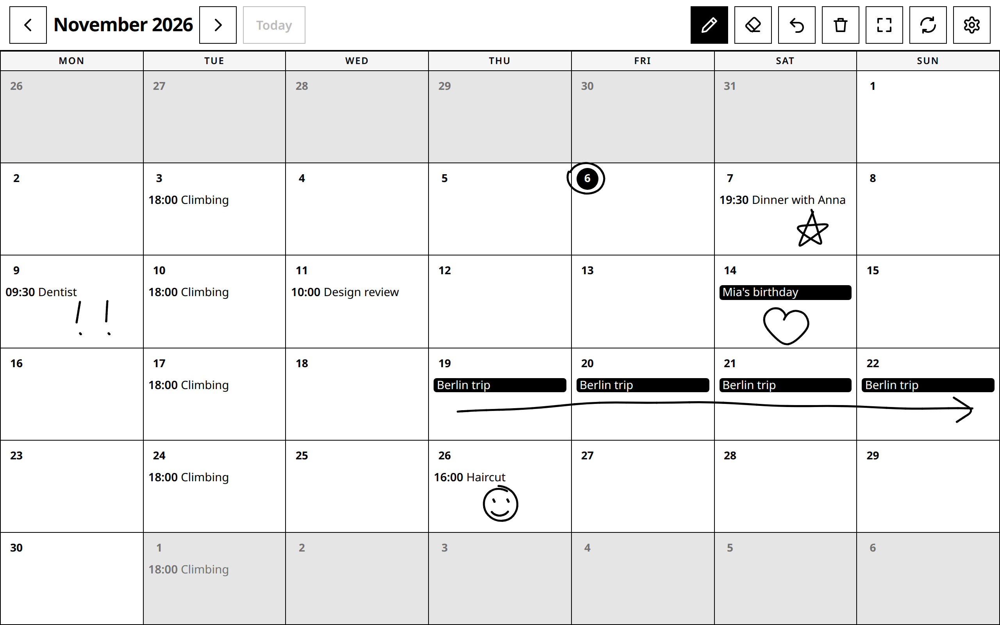

[GitHub](https://github.com/simon-lund/inky-calendar)

On a paper calendar you don't only write notes. You circle a date, underline a deadline, draw a heart on a birthday, sketch an arrow across a trip. Digital calendars are good at structured data, but all you can do with them is type.

So I built Inky calendar. It loads your events from any standard iCal link (Google Calendar, Apple, Nextcloud) and lays them out as a month grid. On top sits a transparent canvas you can draw on with a finger, a pen or a mouse. The events stay data, the marks stay yours.

<video src="/media/inky-calendar/demo.mp4" title="Inky calendar: 30-second walkthrough" controls muted loop playsinline preload="metadata" style="display:block;width:100%;max-width:320px;margin:1.5em auto;border:1px solid var(--color-stone-light);border-radius:0.6rem;"></video>



All events and drawings here are made up.

## Designed for e-ink

It's meant for an e-ink display with touch or pen input, on a wall or a desk: slow-changing, glanceable, something you write on like paper. That kind of screen decides most of the design:

- Black on white with a few light greys. No colour, no gradients.
- No animations or transitions, only state changes, because an e-ink panel refreshes slowly.
- Large, square touch targets. No hover states, no scrolling.

It behaves like a wall calendar, too. It marks today and rolls over at midnight, keeps the screen awake, and goes back to the current month after five minutes without a touch.

## Drawings as data

A month's drawing is one small JSON document, a list of strokes:

```json
{ "v": 2, "strokes": [{ "tool": "pen", "w": 0.0035, "pts": [[0.41, 0.27], [0.42, 0.28]] }] }
```

Every coordinate is a fraction of the canvas, and the stroke width is a fraction of its shorter side. So the same drawing renders on a panel of any size or orientation: a heart drawn on a tablet lands on the same day on a wall screen.

Input comes in as pointer events, so touch, pen and mouse all behave the same. A fast pen stroke arrives as a handful of sparse points, so each stroke is drawn as curves through the midpoints between them rather than straight lines from point to point. Otherwise a quick circle comes out as a polygon. The eraser is just another stroke, one that cuts through the ink beneath it, and undo removes the last stroke.

The drawings are saved per month on the machine that hosts the page, in SQLite, so every screen in the house shows the same calendar. Back up one file, `calendar.db`, and you've backed up everything.

## No accounts

There's no login. Anyone who can reach the page can draw on it, so it belongs on your home network. The iCal link is the one real secret: anyone who has it can read your calendar, so treat it like a password.

## Try it

The code is on [GitHub](https://github.com/simon-lund/inky-calendar), MIT-licensed. It needs Node 22.13 or newer and nothing native to compile, since it uses Node's built-in SQLite. Open it in a kiosk browser on a Raspberry Pi, or add it to a tablet's home screen. Then circle something.
